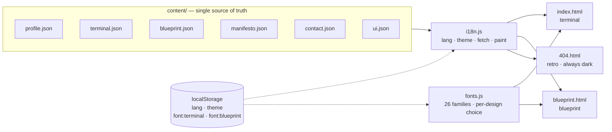

# mahirfatih.github.io

[](https://mahirfatih.com)
[](https://github.com/mahirfatih/mahirfatih.github.io/releases)
[](./fonts/LICENSES.md)
[](./fonts/LICENSES.md)
[](#-local-development)

The personal site of **Mahir Fatih** — *Active Builder, Full-Spectrum Coder & Architect* — published from this repository through GitHub Pages at **[mahirfatih.com](https://mahirfatih.com)**.

Two complete designs sit behind one shared content layer: a **terminal** home page and a **blueprint** sheet, plus an always-dark retro **404**. Plain HTML, CSS and JavaScript — **no build step, no framework, no third-party requests**. Every string lives in JSON, every font is self-hosted.

---

## 📖 Overview

| | |
| :--- | :--- |
| **Live site** | [mahirfatih.com](https://mahirfatih.com) (custom domain via `CNAME`) |
| **Repository** | `mahirfatih/mahirfatih.github.io` — the GitHub Pages source |
| **Current release** | [v2.0.0](https://github.com/mahirfatih/mahirfatih.github.io/releases/tag/v2.0.0) (tags: `v1.0.0`, `v2.0.0`) |
| **Pages** | `index.html` (terminal) · `blueprint.html` (blueprint) · `404.html` (retro, always dark) |
| **Languages** | Turkish + English, switched in place with a `TR / EN` toggle |
| **Stack** | Static HTML5 · CSS3 (custom properties) · vanilla JS · runtime `fetch()` of JSON |
| **Build** | **None** — what you push is what GitHub Pages serves |
| **Weight** | ≈65 KB of HTML + CSS + JS + JSON per page, fonts loaded on demand |



`i18n.js` is design-agnostic: it loads the language, the theme and the JSON, then paints the text. `terminal.js` and `blueprint.js` only render what is specific to their own page.

---

## ✨ Features

- **Two designs, one content layer** — `index.html` renders a terminal session (status bar, boot logs, manifesto, quote); `blueprint.html` renders an engineering sheet (coordinate frame `1–8` × `A–F`, registration marks, scale bar, sticky toolbar, title block). Both read the same `content/*.json`.
- **TR / EN toggle** — instant, no reload, no router. `data-lang` on `<html>`, strings resolved from `content/*.json`.
- **Light / dark theme** — `data-theme` on `<html>`, persisted, `color-scheme` kept in sync so form controls and scrollbars follow.
- **Font picker, remembered per design** — 26 families behind a single button; the choice is stored per design (`font:terminal` / `font:blueprint`), so the terminal can stay on JetBrains Mono while the blueprint uses IBM Plex Sans.
- **Zero build step** — no bundler, no transpiler, no `node_modules`. Content is fetched at runtime; `git push` is the deploy.
- **Self-hosted fonts only** — 50 `woff2` files (1.6 MB library), subset to Latin + Latin Extended, so Turkish `ğ ş İ ı ç ö ü` renders correctly. No Google Fonts, no CDN, no tracking.
- **Responsive 320 → 1280+ px** — verified against common phone widths (iPhone SE/12/14/Pro Max, Galaxy, Pixel); no horizontal overflow, controls wrap onto a second row on narrow screens.
- **Honest SEO** — only the home page is `index, follow`; `blueprint.html` and `404.html` are `noindex, follow`. `sitemap.xml` and `robots.txt` point at the root URL only, with `og-image`, description and `theme-color` meta in place.
- **Accessibility basics** — skip link, `aria-pressed` on toggles, visible `:focus-visible` outlines, `prefers-reduced-motion` respected, `.sr-only` headings for screen readers.

---

## 🛠 Tech stack

| Layer | Choice | Why |
| :--- | :--- | :--- |
| Markup | HTML5, 3 pages | No templating: each page is readable on its own |
| Styling | CSS3 custom properties + 4 stylesheets | `base.css` holds reset, theme mechanism and `@font-face`; each design owns one file |
| Logic | Vanilla JS, 4 IIFE modules | No framework, no dependencies, `use strict` throughout |
| Content | JSON fetched at runtime | One source for both languages and both designs |
| Fonts | `woff2`, self-hosted | Zero third-party requests; full license trail in `fonts/LICENSES.md` |
| Hosting | GitHub Pages + `CNAME` | Free, versioned, deploys on push to `main` |
| Build | **Nothing** | The repository *is* the artifact |

---

## 🎨 Designs

| Page | Design | Default font | Robots | Notes |
| :--- | :--- | :--- | :--- | :--- |
| [`index.html`](./index.html) | Terminal | JetBrains Mono | `index, follow` | Status bar, boot logs, manifesto, quote, contact channels |
| [`blueprint.html`](./blueprint.html) | Blueprint | IBM Plex Sans | `noindex, follow` | Coordinate strips, regmarks, scale bar, sticky toolbar, print sheet |
| [`404.html`](./404.html) | Retro CRT | JetBrains Mono | `noindex, follow` | Always dark, loads only `i18n.js` (no font picker) |

Every page carries `data-design` so styling, storage keys and behaviour stay isolated. Switching between the two designs is a plain link — `Blueprint →` in the terminal header, back to the terminal from the sheet.

---

## 🔤 Fonts

26 families — **24 monospace + 2 sans** — in 50 self-hosted `woff2` files under [`fonts/`](./fonts/). Each was taken from its upstream project, re-encoded to `woff2` and subset to Latin + Latin Extended; that subsetting and conversion are the only modifications. Full license texts and copyright lines live in **[`fonts/LICENSES.md`](./fonts/LICENSES.md)**.

| # | Font | Kind | Weights | License | Upstream |
| :-: | :--- | :--- | :--- | :--- | :--- |
| 1 | JetBrains Mono | mono | 400–700 | OFL-1.1 | [JetBrains/JetBrainsMono](https://github.com/JetBrains/JetBrainsMono) |
| 2 | Cousine | mono | 400 · 700 | OFL-1.1 | [google/fonts · cousine](https://github.com/google/fonts/tree/main/ofl/cousine) |
| 3 | Cascadia Code | mono | 400 · 700 | OFL-1.1 | [microsoft/cascadia-code](https://github.com/microsoft/cascadia-code) |
| 4 | Fira Code | mono | 400 · 700 | OFL-1.1 | [tonsky/FiraCode](https://github.com/tonsky/FiraCode) |
| 5 | Hack | mono | 400 · 700 | MIT + Bitstream Vera | [source-foundry/Hack](https://github.com/source-foundry/Hack) |
| 6 | Victor Mono | mono | 400 · 700 | OFL-1.1 | [rubjo/victor-mono](https://github.com/rubjo/victor-mono) |
| 7 | IBM Plex Mono | mono | 400 · 700 | OFL-1.1 | [IBM/plex](https://github.com/IBM/plex) |
| 8 | Inconsolata | mono | 400 · 700 | OFL-1.1 | [googlefonts/Inconsolata](https://github.com/googlefonts/Inconsolata) |
| 9 | Maple Mono | mono | 400 · 700 | OFL-1.1 | [subframe7536/maple-font](https://github.com/subframe7536/maple-font) |
| 10 | Geist Mono | mono | 400 · 700 | OFL-1.1 | [vercel/geist-font](https://github.com/vercel/geist-font) |
| 11 | Departure Mono | mono | 400 | MIT | [rektdeckard/departure-mono](https://github.com/rektdeckard/departure-mono) |
| 12 | Monaspace (Argon) | mono | 400 · 700 | OFL-1.1 | [githubnext/monaspace](https://github.com/githubnext/monaspace) |
| 13 | Commit Mono | mono | 400 · 700 | MIT | [eigilnikolajsen/commit-mono](https://github.com/eigilnikolajsen/commit-mono) |
| 14 | Source Code Pro | mono | 400 · 700 | OFL-1.1 | [adobe-fonts/source-code-pro](https://github.com/adobe-fonts/source-code-pro) |
| 15 | Martian Mono | mono | 400 · 700 | OFL-1.1 | [google/fonts · martianmono](https://github.com/google/fonts/tree/main/ofl/martianmono) |
| 16 | Space Mono | mono | 400 · 700 | OFL-1.1 | [google/fonts · spacemono](https://github.com/google/fonts/tree/main/ofl/spacemono) |
| 17 | Atkinson Hyperlegible Mono | mono | 400 · 700 | OFL-1.1 | [googlefonts/atkinson-hyperlegible](https://github.com/googlefonts/atkinson-hyperlegible) |
| 18 | Intel One Mono | mono | 400 · 700 | OFL-1.1 | [intel/intel-one-mono](https://github.com/intel/intel-one-mono) |
| 19 | Overpass Mono | mono | 400 · 700 | OFL-1.1 | [RedHatBrand/Overpass](https://github.com/RedHatBrand/Overpass) |
| 20 | Fragment Mono | mono | 400 | OFL-1.1 | [weiweihuanghuang/fragment-mono](https://github.com/weiweihuanghuang/fragment-mono) |
| 21 | Azeret Mono | mono | 400 · 700 | OFL-1.1 | [displaay/Azeret](https://github.com/displaay/Azeret) |
| 22 | Recursive (Mono) | mono | 400 · 700 | OFL-1.1 | [ArrowType/recursive](https://github.com/ArrowType/recursive) |
| 23 | Spline Sans Mono | mono | 400 · 700 | OFL-1.1 | [SorkinType/SplineSansMono](https://github.com/SorkinType/SplineSansMono) |
| 24 | Noto Sans Mono | mono | 400 · 700 | OFL-1.1 | [notofonts/latin-greek-cyrillic](https://github.com/notofonts/latin-greek-cyrillic) |
| 25 | IBM Plex Sans | sans | 400–700 | OFL-1.1 | [IBM/plex](https://github.com/IBM/plex) |
| 26 | IBM Plex Sans Condensed | sans | 400–700 | OFL-1.1 | [IBM/plex](https://github.com/IBM/plex) |

Notes:

- **Only redistributable faces.** Proprietary system fonts (for example Apple's SF Mono) are deliberately absent — no legitimate open distribution exists for them, so they were never vendored.
- **Fallback is built in.** If a face fails to load, `css/base.css` falls back to `ui-monospace, SFMono-Regular, Menlo, Consolas, monospace` (or the system UI stack for the sans families).
- **Only the active family loads.** The library is 1.6 MB on disk, but a page fetches just its own family — a Latin subset is ~31–40 KB.

---

## 📂 Project structure

```text
mahirfatih.github.io/
├── index.html                 # Design 1 — terminal home page (data-design="terminal", index/follow)
├── blueprint.html             # Design 2 — blueprint sheet (data-design="blueprint", noindex/follow)
├── 404.html                   # Retro CRT error page — always dark, noindex, i18n.js only
├── CNAME                      # Custom domain → mahirfatih.com
├── .nojekyll                  # GitHub Pages: serve the files as-is, skip Jekyll
├── robots.txt                 # Allow all crawlers + pointer to the sitemap
├── sitemap.xml                # Canonical root URL only (lastmod maintained by hand)
├── content/                   # THE content layer — every user-visible string, TR + EN
│   ├── profile.json           # name, identity line, work/code start years, version badge
│   ├── terminal.json          # status bar, boot logs, quote, prompts, credits
│   ├── blueprint.json         # sheet line, title block, axis labels, scale, notes
│   ├── manifesto.json         # manifesto paragraphs (limited inline HTML allowed)
│   ├── contact.json           # 6 direct channels + publications link
│   └── ui.json                # control/aria labels shared by both designs
├── css/
│   ├── base.css               # reset · theme mechanism · typography · focus rings · 50 @font-face
│   ├── terminal.css           # design 1 (+ landscape and print media queries)
│   ├── blueprint.css          # design 2 (coordinate frame, scale bar, sticky toolbar, print)
│   └── 404.css                # the always-dark retro window
├── js/
│   ├── i18n.js                # language · theme · content loading · text painting (design-agnostic)
│   ├── fonts.js               # 26-family picker, preference stored per design
│   ├── terminal.js            # design 1: boot logs + manifesto rendering only
│   └── blueprint.js           # design 2: dimension year only (the rest comes from JSON)
├── fonts/                     # 50 self-hosted woff2 files (1.6 MB)
│   └── LICENSES.md            # per-font license, copyright and upstream link + OFL-1.1 / MIT full text
├── images/                    # favicon.png · favicon.svg · og-image.png
└── .gitignore                 # DOMAINS.md — local working notes, never pushed
```

78 tracked files: ~1 770 lines of HTML/CSS/JS, 152 lines of content JSON, 50 font files, plus this README and its Turkish twin.

---

## 🚀 Local development

```bash
git clone https://github.com/mahirfatih/mahirfatih.github.io.git
cd mahirfatih.github.io
python3 -m http.server 8000
# → http://localhost:8000
```

Any static server works (`npx serve`, `php -S`, nginx…). Serve from the repository root — the pages reference assets with **root-absolute paths** (`/css/…`, `/js/…`, `/fonts/…`), so opening `index.html` over `file://` will not load content or fonts.

There is nothing to install, compile or bundle. Requirements: a browser and a static file server.

---

## ⚙️ How it works

**Content at runtime.** Each page `fetch()`es the JSON it needs from `content/` and paints it through `i18n.js`. Add or edit copy there — the HTML never hardcodes user-visible text beyond fallbacks.

**What lives where (single source of truth)**

| Visible item | File / key | Note |
| :--- | :--- | :--- |
| Name, identity line | `content/profile.json` → `name`, `identity` | TR/EN |
| Version badge (`v5.8.0-beta.1`) | `content/profile.json` → `version` | `index.html` fallback is only `v…`; change the version in JSON |
| Codename (`STILL BUILDING`) | `content/terminal.json` → `statusRight` | TR/EN |
| Status bar left text | `content/terminal.json` → `statusLeft` | Small HTML fallback exists |
| Manifesto revision date | `content/terminal.json` → `manifestoVersion` | `son rev` / `last rev`; updated by hand |
| Boot logs | `content/terminal.json` → `logs[]` | `{NOW}` = month, `{WORK_YEARS}` / `{CODE_YEARS}` derived from `profile.json` start years |
| Epigraph | `content/terminal.json` → `quote` | TR/EN |
| Manifesto paragraphs | `content/manifesto.json` → `tr[]` / `en[]` | Limited `<strong>` / `<em>` allowed |
| Blueprint sheet line / scale note | `content/blueprint.json` → `sheetLine`, `heroNote` | Keep the static fallbacks in `blueprint.html` in sync |
| Blueprint axis end year | automatic — `js/blueprint.js` (`dimension-end-year`) | Never written by hand |
| Blueprint initial font | `js/fonts.js` + `blueprint.html` early boot | Defaults to Plex Sans via `font:blueprint` |
| Contact / publications | `content/contact.json` | TR/EN |
| Control and aria labels | `content/ui.json` | Shared by both designs |
| `sitemap.xml` `lastmod` | `sitemap.xml` | Updated by hand |

**Storage keys** (all namespaced, all `localStorage`):

| Key | Values | Owner |
| :--- | :--- | :--- |
| `lang` | `tr` · `en` | `i18n.js` |
| `theme` | `light` · `dark` | `i18n.js` |
| `font:terminal` | any of the 26 family ids | `fonts.js` |
| `font:blueprint` | any of the 26 family ids | `fonts.js` |

`fonts.js` builds its key from `document.documentElement`'s `data-design` attribute, which is why the two designs remember different fonts. The 404 page shares the terminal's styling but loads no font picker.

**Responsibility split.** `i18n.js` = language, theme, content, painting. `fonts.js` = the family list and `data-font`. `terminal.js` / `blueprint.js` = only what is unique to their page. Nothing cross-imports.

---

## 🌐 Deployment

Pushing to `main` publishes — GitHub Pages builds the repository as static files (no workflow file, no Jekyll thanks to `.nojekyll`) and serves them under `mahirfatih.com` from the `CNAME` record.

```bash
git checkout main
git add .
git commit -m "Update copy in content/terminal.json"
git push origin main      # → live at https://mahirfatih.com
```

Release history lives in [GitHub Releases](https://github.com/mahirfatih/mahirfatih.github.io/releases):

| Tag | Commit | Meaning |
| :--- | :--- | :--- |
| [`v1.0.0`](https://github.com/mahirfatih/mahirfatih.github.io/releases) | `1b601db` | Before the restructure: single-file terminal design |
| [`v2.0.0`](https://github.com/mahirfatih/mahirfatih.github.io/releases/tag/v2.0.0) | `d2d3795` | Two designs, shared JSON content, 26 self-hosted fonts |

---

## ✅ Quality checks

- **Responsive:** all three pages verified at 320, 360, 375, 390, 393, 412, 414, 430, 768, 1024 and 1280 px — `scrollWidth` equals the viewport at every width and no element crosses it.
- **Console:** no errors or warnings on any page.
- **Network:** zero third-party requests; fonts, images and content all come from this origin.
- **Links:** `robots.txt`, `sitemap.xml`, `og-image` and every font path return HTTP 200 in production.

---

## 📚 Documentation

- **[`fonts/LICENSES.md`](./fonts/LICENSES.md)** — the font register: 26 rows with license, copyright and upstream link, plus the full SIL OFL 1.1 and MIT/Bitstream Vera texts.

---

## 📜 License

Font assets are distributed under the licenses listed in [`fonts/LICENSES.md`](./fonts/LICENSES.md) — **SIL OFL 1.1** and **MIT / Bitstream Vera** — with their upstream copyright notices intact.

---

**Türkçe:** [README.tr.md](./README.tr.md)
