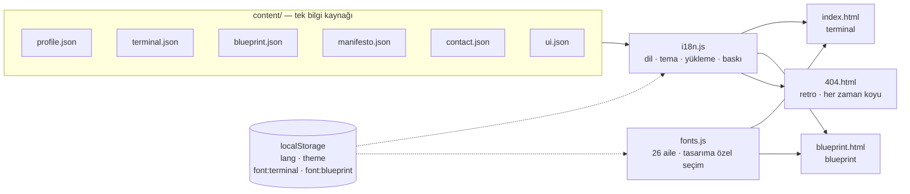

# mahirfatih.github.io

[](https://mahirfatih.com)
[](https://github.com/mahirfatih/mahirfatih.github.io/releases)
[](./fonts/LICENSES.md)
[](./fonts/LICENSES.md)
[](#yerel-gelistirme)

| 🎯 Amaç | 🖥️ Tasarımlar | 🌐 Diller | 🧱 Build |
| :---: | :---: | :---: | :---: |
| Mahir Fatih'in kişisel sitesi | Terminal · blueprint · retro 404 | TR / EN · açık / koyu | Statik — `git push` yayındır |

> **Yeni misin?** [Üç sayfaya bak](#tasarimlar) · [Yerelde çalıştır](#yerel-gelistirme) · [Dokümanlara göz at](#dokumantasyon)

**Mahir Fatih** — *Active Builder, Full-Spectrum Coder & Architect* — kişisel sitesi. Bu depodan GitHub Pages ile yayınlanır: **[mahirfatih.com](https://mahirfatih.com)**.

Tek bir ortak içerik katmanının arkasında iki tam tasarım duruyor: bir **terminal** ana sayfası ve bir **blueprint** sayfası; artı her zaman koyu, retro bir **404**. Saf HTML, CSS ve JavaScript — **build adımı yok, framework yok, üçüncü taraf istek yok**. Her metin JSON'da, her yazı tipi kendi sunucumuzda (self-hosted).

> **İki şeyi bilerek başla:** varlıklar kök-kesin yollarla çağrılır, bu yüzden depo kökten sunulmalı ([yerel geliştirme](#yerel-gelistirme)); `lang`, `theme` ve tasarıma özel font seçimi `localStorage`'da tutulur ([depolama anahtarları](#depolama-anahtarlari)) — hesap, sunucu veya telemetri yok.

---

<a id="icerikler"></a>

## 🧭 İçindekiler

| # | Bölüm | Ne yanıtlar? |
| :---: | :--- | :--- |
| 01 | [📖 Genel bakış](#genel-bakis) | Bu depo ne yayınlar, parçalar nasıl oturur |
| 02 | [✨ Özellikler](#ozellikler) | Sıfır build aracıyla ne gelir |
| 03 | [🛠 Teknolojiler](#teknoloji) | Her katman neden seçildi |
| 04 | [🎨 Tasarımlar](#tasarimlar) | Üç sayfa ve rolleri |
| 05 | [🔤 Fontlar](#fontlar) | 26 aile, lisanslar ve yükleme kuralları |
| 06 | [📂 Klasör yapısı](#klasor-yapisi) | Her dosya nerede |
| 07 | [🚀 Yerel geliştirme](#yerel-gelistirme) | Makinede çalıştır |
| 08 | [⚙️ Nasıl çalışıyor](#nasil-calisir) | Çalışma anında içerik, depolama, sorumluluk ayrımı |
| 09 | [🌐 Yayın](#yayin) | Push ile yayın ve sürüm geçmişi |
| 10 | [✅ Kalite kontrolleri](#kalite-kontrolleri) | Gerçekte ne doğrulandı |
| 11 | [📚 Dokümantasyon](#dokumantasyon) | Daha fazla okuma |
| 12 | [📜 Lisans](#lisans) | Font varlıklarının koşulları |

<details>
<summary>🔎 <b>Ayrıntılara atla</b></summary>

- [🧩 Çalışma anında içerik](#icerik-calisma-aninda)
- [📍 Tek kaynak](#tek-kaynak)
- [🔑 localStorage anahtarları](#depolama-anahtarlari)
- [📝 Font notları ve yedek](#font-notlari)
- [🏷️ Sürüm geçmişi](#surum-gecmisi)

</details>

---

<a id="genel-bakis"></a>

## 📖 Genel bakış

| | |
| :--- | :--- |
| **Canlı site** | [mahirfatih.com](https://mahirfatih.com) (`CNAME` ile özel alan adı) |
| **Depo** | `mahirfatih/mahirfatih.github.io` — GitHub Pages kaynağı |
| **Güncel sürüm** | [v2.0.0](https://github.com/mahirfatih/mahirfatih.github.io/releases/tag/v2.0.0) (etiketler: `v1.0.0`, `v2.0.0`) |
| **Sayfalar** | `index.html` (terminal) · `blueprint.html` (blueprint) · `404.html` (retro, her zaman koyu) |
| **Diller** | Türkçe + İngilizce, `TR / EN` düğmesiyle yerinde geçiş |
| **Teknoloji** | Statik HTML5 · CSS3 (custom properties) · saf JS · çalışma anında JSON `fetch()` |
| **Build** | **Yok** — ne itersen GitHub Pages onu yayınlar |
| **Ağırlık** | Sayfa başına ≈65 KB HTML + CSS + JS + JSON, fontlar ihtiyaçta yüklenir |



`i18n.js` tasarım bilmez: dili, temayı ve JSON'u yükler, metni basar. `terminal.js` ile `blueprint.js` yalnızca kendi sayfalarına özgü olanı çizer.

---

<a id="ozellikler"></a>

## ✨ Özellikler

- **İki tasarım, tek içerik katmanı** — `index.html` bir oturum çizer (durum çubuğu, açılış logları, manifesto, alıntı); `blueprint.html` bir teknik resim sayfası (koordinat çerçevesi `1–8` × `A–F`, registrasyon işaretleri, ölçek çubuğu, yapışkan araç çubuğu, antet bloğu). İkisi de aynı `content/*.json` dosyalarını okur.
- **TR / EN geçişi** — anında, yeniden yükleme yok, yönlendirici yok. `<html>` üzerinde `data-lang`; metinler `content/*.json` içinden gelir.
- **Açık / koyu tema** — `<html>` üzerinde `data-theme`, kalıcı; `color-scheme` senkron olduğu için form denetimleri ve kaydırma çubukları da temaya uyar.
- **Tasarıma göre hatırlanan yazı tipi seçimi** — tek düğmenin ardında 26 aile; seçim ayrı anahtarlarda tutulur (`font:terminal` / `font:blueprint`), terminal JetBrains Mono'da kalıp blueprint IBM Plex Sans'e geçebilir.
- **Sıfır build adımı** — paketleyici, transpilatör, `node_modules` yok. İçerik çalışma anında çekilir; deploy = `git push`.
- **Yalnızca self-hosted font** — 50 `woff2` (1.6 MB kütüphane), Latin + Latin Extended'a alt kümelendi; böylece Türkçe `ğ ş İ ı ç ö ü` doğru görünür. Google Fonts yok, CDN yok, izleme yok.
- **320 → 1280+ px duyarlı** — yaygın telefon genişliklerinde (iPhone SE/12/14/Pro Max, Galaxy, Pixel) doğrulandı: yatay taşma yok, dar ekranda denetimler ikinci satıra sarılır.
- **Dürüst SEO** — yalnızca ana sayfa `index, follow`; `blueprint.html` ve `404.html` `noindex, follow`. `sitemap.xml` ve `robots.txt` yalnızca kök URL'yi gösterir; `og-image`, açıklama ve `theme-color` meta yerinde.
- **Erişilebilirlik temelleri** — içeriğe geç bağlantısı, anahtarlarda `aria-pressed`, görünür `:focus-visible` çerçeveleri, `prefers-reduced-motion` desteği, ekran okuyucular için `.sr-only` başlıklar.

---

<a id="teknoloji"></a>

## 🛠 Teknolojiler

| Katman | Seçim | Neden |
| :--- | :--- | :--- |
| İşaret dili | HTML5, 3 sayfa | Şablonlama yok: her sayfa tek başına okunabilir |
| Stil | CSS3 custom properties + 4 stil dosyası | `base.css` reset, tema mekanizması ve `@font-face` tutar; her tasarım bir dosyaya sahip |
| Mantık | Saf JS, 4 IIFE modülü | Framework yok, bağımlılık yok, her yerde `use strict` |
| İçerik | Çalışma anında çekilen JSON | İki dil ve iki tasarım için tek kaynak |
| Fontlar | `woff2`, self-hosted | Üçüncü taraf istek yok; tam lisans izi `fonts/LICENSES.md` içinde |
| Barındırma | GitHub Pages + `CNAME` | Ücretsiz, sürümlü, `main`'e push ile yayına girer |
| Build | **Hiçbir şey** | Depo kendisi çıktıdır |

---

<a id="tasarimlar"></a>

## 🎨 Tasarımlar

| Sayfa | Tasarım | Varsayılan font | Robots | Notlar |
| :--- | :--- | :--- | :--- | :--- |
| [`index.html`](./index.html) | Terminal | JetBrains Mono | `index, follow` | Durum çubuğu, açılış logları, manifesto, alıntı, iletişim kanalları |
| [`blueprint.html`](./blueprint.html) | Blueprint | IBM Plex Sans | `noindex, follow` | Koordinat şeritleri, regmark'lar, ölçek çubuğu, yapışkan araç çubuğu, baskı sayfası |
| [`404.html`](./404.html) | Retro CRT | JetBrains Mono | `noindex, follow` | Her zaman koyu, yalnızca `i18n.js` yükler (font seçici yok) |

Her sayfa `data-design` taşır; böylece stil, depolama anahtarları ve davranış ayrışır. İki tasarım arası geçiş düz bir bağlantıdır — terminal başlığındaki `Blueprint →`, sayfadan geriye terminal bağlantısı.

---

<a id="fontlar"></a>

## 🔤 Fontlar

26 aile — **24 monospace + 2 sans** — [`fonts/`](./fonts/) altında 50 adet self-hosted `woff2` dosyası. Her biri üst projesinden alındı, `woff2`'ye çevrildi ve Latin + Latin Extended'a alt kümelendi; alt kümeleme ve format dönüşümü tek yapılan değişikliktir. Tam lisans metinleri ve telif satırları **[`fonts/LICENSES.md`](./fonts/LICENSES.md)** içinde.

| # | Font | Tür | Ağırlıklar | Lisans | Kaynak |
| :-: | :--- | :--- | :--- | :--- | :--- |
| 1 | JetBrains Mono | mono | 400–700 | OFL-1.1 | [JetBrains/JetBrainsMono](https://github.com/JetBrains/JetBrainsMono) |
| 2 | Cousine | mono | 400 · 700 | OFL-1.1 | [google/fonts · cousine](https://github.com/google/fonts/tree/main/ofl/cousine) |
| 3 | Cascadia Code | mono | 400 · 700 | OFL-1.1 | [microsoft/cascadia-code](https://github.com/microsoft/cascadia-code) |
| 4 | Fira Code | mono | 400 · 700 | OFL-1.1 | [tonsky/FiraCode](https://github.com/tonsky/FiraCode) |
| 5 | Hack | mono | 400 · 700 | MIT + Bitstream Vera | [source-foundry/Hack](https://github.com/source-foundry/Hack) |
| 6 | Victor Mono | mono | 400 · 700 | OFL-1.1 | [rubjo/victor-mono](https://github.com/rubjo/victor-mono) |
| 7 | IBM Plex Mono | mono | 400 · 700 | OFL-1.1 | [IBM/plex](https://github.com/IBM/plex) |
| 8 | Inconsolata | mono | 400 · 700 | OFL-1.1 | [googlefonts/Inconsolata](https://github.com/googlefonts/Inconsolata) |
| 9 | Maple Mono | mono | 400 · 700 | OFL-1.1 | [subframe7536/maple-font](https://github.com/subframe7536/maple-font) |
| 10 | Geist Mono | mono | 400 · 700 | OFL-1.1 | [vercel/geist-font](https://github.com/vercel/geist-font) |
| 11 | Departure Mono | mono | 400 | MIT | [rektdeckard/departure-mono](https://github.com/rektdeckard/departure-mono) |
| 12 | Monaspace (Argon) | mono | 400 · 700 | OFL-1.1 | [githubnext/monaspace](https://github.com/githubnext/monaspace) |
| 13 | Commit Mono | mono | 400 · 700 | MIT | [eigilnikolajsen/commit-mono](https://github.com/eigilnikolajsen/commit-mono) |
| 14 | Source Code Pro | mono | 400 · 700 | OFL-1.1 | [adobe-fonts/source-code-pro](https://github.com/adobe-fonts/source-code-pro) |
| 15 | Martian Mono | mono | 400 · 700 | OFL-1.1 | [google/fonts · martianmono](https://github.com/google/fonts/tree/main/ofl/martianmono) |
| 16 | Space Mono | mono | 400 · 700 | OFL-1.1 | [google/fonts · spacemono](https://github.com/google/fonts/tree/main/ofl/spacemono) |
| 17 | Atkinson Hyperlegible Mono | mono | 400 · 700 | OFL-1.1 | [googlefonts/atkinson-hyperlegible](https://github.com/googlefonts/atkinson-hyperlegible) |
| 18 | Intel One Mono | mono | 400 · 700 | OFL-1.1 | [intel/intel-one-mono](https://github.com/intel/intel-one-mono) |
| 19 | Overpass Mono | mono | 400 · 700 | OFL-1.1 | [RedHatBrand/Overpass](https://github.com/RedHatBrand/Overpass) |
| 20 | Fragment Mono | mono | 400 | OFL-1.1 | [weiweihuanghuang/fragment-mono](https://github.com/weiweihuanghuang/fragment-mono) |
| 21 | Azeret Mono | mono | 400 · 700 | OFL-1.1 | [displaay/Azeret](https://github.com/displaay/Azeret) |
| 22 | Recursive (Mono) | mono | 400 · 700 | OFL-1.1 | [ArrowType/recursive](https://github.com/ArrowType/recursive) |
| 23 | Spline Sans Mono | mono | 400 · 700 | OFL-1.1 | [SorkinType/SplineSansMono](https://github.com/SorkinType/SplineSansMono) |
| 24 | Noto Sans Mono | mono | 400 · 700 | OFL-1.1 | [notofonts/latin-greek-cyrillic](https://github.com/notofonts/latin-greek-cyrillic) |
| 25 | IBM Plex Sans | sans | 400–700 | OFL-1.1 | [IBM/plex](https://github.com/IBM/plex) |
| 26 | IBM Plex Sans Condensed | sans | 400–700 | OFL-1.1 | [IBM/plex](https://github.com/IBM/plex) |

<a id="font-notlari"></a>

### 📝 Notlar

- **Yalnızca yeniden dağıtılabilir aileler.** Tescilli sistem fontları (ör. Apple'ın SF Mono'su) bilinçli olarak yok — bunlar için meşru bir açık dağıtım yolunun olmaması yeterli sebep; hiç eklenmedi.
- **Yedek yerleşik.** Bir font yüklenemezse `css/base.css` içindeki yedeğe düşer: `ui-monospace, SFMono-Regular, Menlo, Consolas, monospace` (sans aileler için sistem arayüz yığını).
- **Yalnızca etkin aile yüklenir.** Kütüphane diskte 1.6 MB; bir sayfa kendi ailesini çeker — Latin alt kümesi ≈31–40 KB.

---

<a id="klasor-yapisi"></a>

## 📂 Klasör yapısı

```text
mahirfatih.github.io/
├── index.html                 # Tasarım 1 — terminal ana sayfa (data-design="terminal", index/follow)
├── blueprint.html             # Tasarım 2 — blueprint sayfası (data-design="blueprint", noindex/follow)
├── 404.html                   # Retro CRT hata sayfası — her zaman koyu, noindex, yalnızca i18n.js
├── CNAME                      # Özel alan adı → mahirfatih.com
├── .nojekyll                  # GitHub Pages: dosyalar aynen sunulsun, Jekyll işlemesin
├── robots.txt                 # Tüm botlara izin + sitemap bağlantısı
├── sitemap.xml                # Yalnızca kök URL (lastmod elle güncellenir)
├── content/                   # İÇERİK katmanı — görünen her metin, TR + EN
│   ├── profile.json           # ad, kimlik satırı, iş/kod başlangıç yılları, sürüm rozeti
│   ├── terminal.json          # durum çubuğu, açılış logları, alıntı, istemler, künye
│   ├── blueprint.json         # sayfa satırı, antet bloğu, eksen etiketleri, ölçek, notlar
│   ├── manifesto.json         # manifesto paragrafları (sınırlı satır içi HTML)
│   ├── contact.json           # 6 doğrudan kanal + yayınlar bağlantısı
│   └── ui.json                # iki tasarımın paylaştığı denetim/aria etiketleri
├── css/
│   ├── base.css               # reset · tema mekanizması · tipografi · odak halkaları · 50 @font-face
│   ├── terminal.css           # tasarım 1 (+ yatay ekran ve baskı media sorguları)
│   ├── blueprint.css          # tasarım 2 (koordinat çerçevesi, ölçek çubuğu, yapışkan çubuk, baskı)
│   └── 404.css                # her zaman koyu retro pencere
├── js/
│   ├── i18n.js                # dil · tema · içerik yükleme · metin baskısı (tasarım bilmez)
│   ├── fonts.js               # 26 ailelik seçici, tercih tasarıma göre saklanır
│   ├── terminal.js            # tasarım 1: yalnızca açılış logları + manifesto
│   └── blueprint.js           # tasarım 2: yalnızca ölçü yılı (gerisi JSON'dan)
├── fonts/                     # 50 self-hosted woff2 dosyası (1.6 MB)
│   └── LICENSES.md            # font başına lisans, telif ve kaynak bağlantısı + OFL-1.1 / MIT tam metni
├── images/                    # favicon.png · favicon.svg · og-image.png
└── .gitignore                 # DOMAINS.md — yerel çalışma notları, asla push edilmez
```

78 izlenen dosya: ≈1 770 satır HTML/CSS/JS, 152 satır içerik JSON'u, 50 font dosyası, artı bu README ve Türkçe ikizi.

---

<a id="yerel-gelistirme"></a>

## 🚀 Yerel geliştirme

```bash
git clone https://github.com/mahirfatih/mahirfatih.github.io.git
cd mahirfatih.github.io
python3 -m http.server 8000
# → http://localhost:8000
```

Herhangi bir statik sunucu olur (`npx serve`, `php -S`, nginx…). Sunucu deposun kökünden çalışsın — sayfalar varlıkları **kök-kesin yollarla** çağırır (`/css/…`, `/js/…`, `/fonts/…`), bu yüzden `index.html`'i `file://` üzerinden açmak içerik ve fontları yüklemez.

Kurulacak, derlenecek, paketlenecek hiçbir şey yok. Gereksinim: bir tarayıcı ve bir statik dosya sunucusu.

---

<a id="nasil-calisir"></a>

## ⚙️ Nasıl çalışıyor

<a id="icerik-calisma-aninda"></a>

### 🧩 Çalışma anında içerik

Her sayfa ihtiyacı olan JSON'u `content/`'ten çeker ve `i18n.js` üzerinden basar. Metni orada düzenleyin — HTML'de kullanıcının göreceği metin (yedekler dışında) sabit yazılmaz.

<a id="tek-kaynak"></a>

### 📍 Nerede ne yazılır? (tek kaynak)

| Görünen öğe | Dosya / anahtar | Not |
| :--- | :--- | :--- |
| Ad, kimlik satırı | `content/profile.json` → `name`, `identity` | TR/EN |
| Sürüm rozeti (`v5.8.0-beta.1`) | `content/profile.json` → `version` | `index.html` yedeği yalnızca `v…`; sürümü JSON'dan değiştir |
| Kod adı (`STILL BUILDING`) | `content/terminal.json` → `statusRight` | TR/EN |
| Durum çubuğu sol metin | `content/terminal.json` → `statusLeft` | Küçük HTML yedeği var |
| Manifesto rev tarihi | `content/terminal.json` → `manifestoVersion` | `son rev` / `last rev`; elle güncellenir |
| Açılış logları | `content/terminal.json` → `logs[]` | `{NOW}` = ay, `{WORK_YEARS}` / `{CODE_YEARS}` = `profile.json` başlangıç yıllarından otomatik |
| Alıntı | `content/terminal.json` → `quote` | TR/EN |
| Manifesto paragrafları | `content/manifesto.json` → `tr[]` / `en[]` | Sınırlı `<strong>` / `<em>` kullanılabilir |
| Blueprint antet / ölçek notu | `content/blueprint.json` → `sheetLine`, `heroNote` | `blueprint.html` içindeki statik yedekler de aynı olmalı |
| Blueprint eksen bitiş yılı | otomatik — `js/blueprint.js` (`dimension-end-year`) | Elle yazılmaz |
| Blueprint ilk fontu | `js/fonts.js` + `blueprint.html` early boot | Varsayılan Plex Sans, `font:blueprint` |
| İletişim / yayınlar | `content/contact.json` | TR/EN |
| Denetim ve aria etiketleri | `content/ui.json` | İki tasarımın paylaştığı metinler |
| `sitemap.xml` `lastmod` | `sitemap.xml` | Elle güncellenir |

<a id="depolama-anahtarlari"></a>

### 🔑 Depolama anahtarları

Hepsi isimlendirilmiş, hepsi `localStorage`:

| Anahtar | Değerler | Sahibi |
| :--- | :--- | :--- |
| `lang` | `tr` · `en` | `i18n.js` |
| `theme` | `light` · `dark` | `i18n.js` |
| `font:terminal` | 26 aile kimliğinden biri | `fonts.js` |
| `font:blueprint` | 26 aile kimliğinden biri | `fonts.js` |

`fonts.js` anahtarını `<html>`'deki `data-design` özniteliğinden üretir; iki tasarımın bu yüzden farklı fontları hatırlaması budur. 404 sayfası terminalin stilini paylaşır ama font seçicisini yüklemez.

### 🧱 Sorumluluk ayrımı

`i18n.js` = dil, tema, içerik, baskı. `fonts.js` = aile listesi ve `data-font`. `terminal.js` / `blueprint.js` = yalnızca kendi sayfasına özgü olan. Hiçbiri birbirini içe aktarmaz.

---

<a id="yayin"></a>

## 🌐 Yayın

`main`'e push etmek yayındır — GitHub Pages depoyu statik dosya olarak yayınlar (workflow dosyası yok, `.nojekyll` sayesinde Jekyll yok) ve `CNAME` kaydı altında `mahirfatih.com` adresinden sunar.

```bash
git checkout main
git add .
git commit -m "content/terminal.json içindeki metni güncelle"
git push origin main      # → https://mahirfatih.com'da canlı
```

<a id="surum-gecmisi"></a>

### 🏷️ Sürüm geçmişi

Sürüm geçmişi [GitHub Releases](https://github.com/mahirfatih/mahirfatih.github.io/releases) içinde:

| Etiket | Commit | Anlamı |
| :--- | :--- | :--- |
| [`v1.0.0`](https://github.com/mahirfatih/mahirfatih.github.io/releases) | `1b601db` | Yeniden yapılandırma öncesi: tek dosyalık terminal tasarımı |
| [`v2.0.0`](https://github.com/mahirfatih/mahirfatih.github.io/releases/tag/v2.0.0) | `d2d3795` | İki tasarım, ortak JSON içerik, 26 self-hosted font |
| [`v2.0.1`](https://github.com/mahirfatih/mahirfatih.github.io/releases/tag/v2.0.1) | `3eb0a31` | Çalışma anında yıl/ay token'ları, manifesto revizyonu, blueprint'te Plex Sans varsayılanı |

---

<a id="kalite-kontrolleri"></a>

## ✅ Kalite kontrolleri

- **Duyarlı:** üç sayfa da 320, 360, 375, 390, 393, 412, 414, 430, 768, 1024 ve 1280 px'de doğrulandı — her genişlikte `scrollWidth` görünür alana eşit, görünür alanı aşan öğe yok.
- **Konsol:** hiçbir sayfada hata veya uyarı yok.
- **Ağ:** üçüncü taraf istek sıfır; fontlar, görseller ve içerik hep bu kökenden.
- **Bağlantılar:** üretimde `robots.txt`, `sitemap.xml`, `og-image` ve tüm font yolları HTTP 200 döner.

---

<a id="dokumantasyon"></a>

## 📚 Dokümantasyon

- **[`fonts/LICENSES.md`](./fonts/LICENSES.md)** — font sicili: 26 satır, lisans + telif + kaynak bağlantısı, artı SIL OFL 1.1 ve MIT/Bitstream Vera tam metinleri.

---

<a id="lisans"></a>

## 📜 Lisans

Font varlıkları [`fonts/LICENSES.md`](./fonts/LICENSES.md) içinde listelenen lisanslara göre dağıtılır — **SIL OFL 1.1** ve **MIT / Bitstream Vera** — üst projelerin telif bildirimleri korunarak.

---

**English:** [README.md](./README.md)
